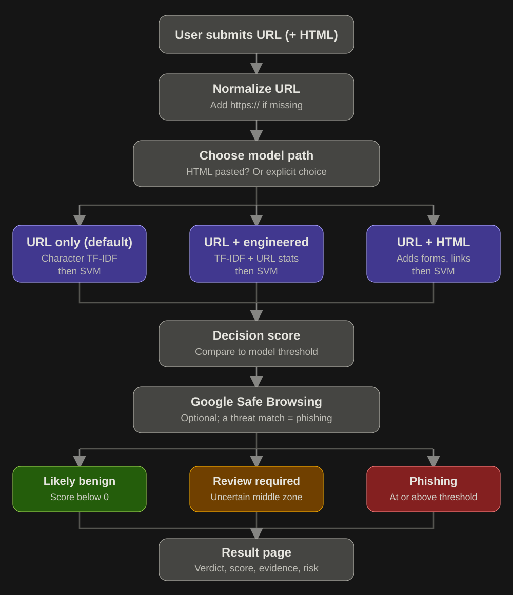
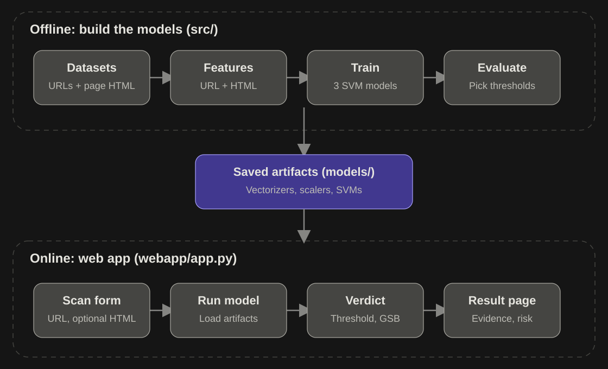

# PHISH//X — Explainable Phishing Website Detection

PHISH//X is a machine-learning phishing website detector. The web application analyzes a submitted URL and can also analyze pasted HTML when the URL+HTML backend mode is selected. Depending on the model score and optional threat-intelligence result, it returns a phishing, likely-benign, or review verdict alongside observable URL/HTML evidence and a qualitative risk signal.

## Quick start

```powershell
python -m venv .venv
.\.venv\Scripts\python.exe -m pip install -r requirements.txt
.\run.ps1
```

Open `http://127.0.0.1:8000` and scan a URL. Stop the server with **Ctrl+C**.

## Requirements

- Python 3.9
- The pinned dependencies in `requirements.txt` (FastAPI, Uvicorn, Jinja2, scikit-learn, pandas, SciPy, joblib, BeautifulSoup, python-multipart)
- No dataset or retraining is needed to run the app: the fitted vectorizers, classifiers, scalers, and feature-column lists are committed under `models/`

## Setup

From the project root:

```powershell
python -m venv .venv
.\.venv\Scripts\python.exe -m pip install --upgrade pip
.\.venv\Scripts\python.exe -m pip install -r requirements.txt
```

## Run

Two equivalent ways to start the server from the project root:

```powershell
.\run.ps1
```

```powershell
.\.venv\Scripts\python.exe -m uvicorn webapp.app:app --host 127.0.0.1 --port 8000
```

Then open `http://127.0.0.1:8000`. Restart the server after changing any Python file.

## Configuration: optional threat intelligence

Google Safe Browsing is optional. Without a key the app runs its local models only and the result page says threat intelligence is not configured.

To enable it, copy `.env.example` to `.env` and fill in the key:

```powershell
Copy-Item .env.example .env
```

`webapp/app.py` reads the root `.env` file at startup. A value already present in the process environment wins over the file, so an exported variable is never overridden. `.env` is ignored by Git; never commit or share the key.

When enabled, the full submitted URL is sent to Google for lookup. An explicit malware or social-engineering match overrides the model verdict to `PHISHING`; a no-match is not proof that a URL is legitimate, and uncertain model results remain `REVIEW REQUIRED`.

## Tests

The focused regression suite runs without a server and without live API calls (Safe Browsing responses are mocked):

```powershell
powershell -NoProfile -ExecutionPolicy Bypass -File .\tasks.ps1 test
```

It covers the reported false-positive and false-negative URLs, the review band and threshold boundaries, automatic URL+HTML routing when HTML is pasted, the Safe Browsing match/override/missing-key/failure paths, and the rendered result template.

## Project structure

```text
phishing-website-detector/
├── .env.example             # Template for the optional local key
├── .gitignore
├── data/                    # Not tracked: raw shards, processed features, splits, benchmark cache
├── docs/                    # Architecture diagrams used by this README
├── handoff/                 # Local project notes (not tracked)
├── logs/                    # Run/training logs (not tracked)
├── models/                  # Committed model and preprocessing artifacts
├── patch/
│   ├── backups/             # Pre-threshold-change webapp originals
│   ├── tests/               # Model and threat-intelligence regression tests
│   ├── ROOT_CAUSE.md        # False-positive investigation
│   ├── TEST_REPORT.md       # Commands run and evaluation limits
│   ├── CHANGELOG.md         # Threshold patch history
│   └── ROLLBACK.md          # Restore instructions for the saved originals
├── results/                 # Evaluation outputs (not tracked)
├── src/
│   ├── data/                # Dataset inspection and profiling utilities
│   ├── evaluation/          # Model evaluation, threshold, and benchmark scripts
│   ├── features/            # URL and HTML feature extraction
│   ├── models/              # Training and comparison scripts
│   └── reputation/          # Optional Google Safe Browsing lookup
├── webapp/
│   ├── static/
│   │   ├── app.js           # Browser-side interactions
│   │   └── style.css        # Layout and responsive styling
│   ├── templates/
│   │   └── index.html       # Scan form and rendered result
│   └── app.py               # FastAPI entry point and inference orchestration
├── README.md
├── requirements.txt
└── run.ps1                  # Local launcher (port 8000)
```

### Important components

| Component | Responsibility |
|---|---|
| `webapp/app.py` | Loads model artifacts and the optional `.env` key, handles `/` and `/scan`, prepares model inputs, selects a model path, classifies the decision score, and assembles the result context. |
| `src/features/url_features.py` | Extracts URL length, hostname/path properties, character counts, subdomains, query parameters, IP/`@` indicators, HTTPS, and suspicious-word counts. |
| `src/features/html_features.py` | Extracts page structure such as forms, inputs, password fields, links, scripts, iframes, and external form destinations from supplied HTML. |
| `webapp/templates/index.html` | Renders the form, scan result, feature summaries, evidence, and uncertainty messaging. |
| `webapp/static/app.js` | Handles client-side form feedback and small UI interactions. |
| `webapp/static/style.css` | Provides visual styling and responsive result alignment. |
| `models/` | Holds the fitted vectorizers, SVM classifiers, scalers, and saved feature-column lists required by the app. |
| `src/reputation/google_safe_browsing.py` | Performs an optional Google Safe Browsing URL lookup when an API key is configured. |
| `src/models/` and `src/evaluation/` | Contain offline training and analysis code; they are separate from normal web inference. |

## Architecture

### Online scan flow



### Model training and app flow



### Inference flow

1. The browser submits a URL and optional pasted HTML to `POST /scan`.
2. `webapp/app.py` normalizes a scheme-less URL by prefixing `https://`.
3. The backend selects a model from the `model_choice` request field. If omitted, it uses URL-only analysis when no HTML is supplied and URL+HTML analysis when HTML is supplied.
4. The selected vectorizer and any required feature extractor/scaler transform the input into the feature representation expected by that trained model.
5. The selected LinearSVC produces a decision score. A model-specific threshold determines the binary prediction; score thresholds are not interchangeable between models.
6. When configured, the app sends the submitted URL to Google Safe Browsing. A reported threat match overrides the model verdict to phishing; no match is not treated as proof of safety. If the lookup is unavailable or not configured, its status is displayed and local model behavior remains in effect.
7. The app builds an evidence list from observable extracted features and a risk-level signal, then renders them through `index.html`.

### Available model paths

| Backend choice | Input representation | Model artifacts |
|---|---|---|
| `url_tfidf` (default) | Character-level URL TF-IDF features | `url_tfidf.joblib`, `url_linear_svm.joblib` |
| `url_engineered` | URL TF-IDF plus scaled engineered URL features | `combined_tfidf.joblib`, `url_engineered_scaler.joblib`, `combined_linear_svm.joblib` |
| `url_html` | URL TF-IDF plus scaled URL and HTML structural features | `url_html_tfidf.joblib`, URL scaler, `html_scaler.joblib`, `html_feature_columns.joblib`, `url_html_linear_svm.joblib` |

The current HTML page does not expose a model selector. Normal form submissions automatically use the URL+HTML path when non-empty HTML is pasted; otherwise they use the URL-only default. A client can explicitly submit `model_choice` to select a backend.

## Classification and presentation

`CLASSIFICATION_THRESHOLDS` in `webapp/app.py` currently sets `url_tfidf` to `1.5`, while `url_engineered` and `url_html` remain at `0.0`. Scores below zero are labeled `LIKELY BENIGN`; positive URL-only scores below `1.5` are labeled `REVIEW REQUIRED`; scores at or above the selected model's threshold are labeled `PHISHING`. Risk signals are shown separately from the verdict.

An explicit malware or social-engineering match from configured Google Safe Browsing overrides the model verdict to `PHISHING`. No match, an unavailable service, or a missing key does not count as proof of safety; model uncertainty remains `REVIEW REQUIRED`.

The URL-only threshold is a targeted mitigation for an observed false positive, not a threshold validated against a matching labeled validation set. The available saved threshold report belongs to the URL+engineered model and is not applied to URL-only inference. The LinearSVC decision score is not a calibrated probability, so the UI reports the raw score and threshold instead of a percentage.

## Retraining and evaluation

The training scripts are offline research code and are not imported by the web app:

| Script | Produces |
|---|---|
| `src/models/train_url_baseline.py` | URL-only TF-IDF vectorizer and classifier |
| `src/models/train_url_combined.py` | URL TF-IDF plus engineered-feature model |
| `src/models/train_url_html2.py` | URL+HTML model and its scalers/feature-column list |

They read the labeled parquet shards under `data/raw/data/`, which are not tracked because of size. `src/features/process_html_dataset.py` builds the HTML feature dataset and `src/features/verify_html_dataset.py` checks it.

Evaluation and analysis live in `src/evaluation/` (`evaluate_url_baseline.py`, `evaluate_url_combined.py`, `evaluate_url_html_test.py`, `evaluate_benchmarks.py`, `find_validation_threshold.py`, `threshold_analysis.py`, `analyze_errors.py`, `feature_importance.py`), with outputs written to `results/`. See `patch/TEST_REPORT.md` for the recorded evaluation commands and their caveats.

Retraining is only needed if you want different artifacts. To use new artifacts, keep the filenames listed in the model table above and place them in `models/`.

## Usage examples

| Input | Expected behavior |
|---|---|
| `example.com` | Scheme added automatically; URL-only model runs |
| `https://notebook.google.com/?icid=home_maincta` | URL-only score above zero but below `1.5`; labeled `REVIEW REQUIRED` |
| `https://orca-app-2ulpy.ondigitalocean.app` | URL-only `REVIEW REQUIRED`; `PHISHING` if Safe Browsing reports a match |
| Any URL plus pasted page HTML | Routes to the URL+HTML model and adds HTML structural evidence |

## Known limitations

- The URL-only model sees only URL text; it does not fetch or inspect the live page. Paste the HTML to use structural signals.
- LinearSVC decision scores are uncalibrated and are not probabilities, and thresholds differ per model.
- The `1.5` URL-only threshold is a targeted mitigation whose false-negative cost has not been measured on a representative labeled validation set.
- Safe Browsing no-match responses indicate only that the URL was not on the queried lists at that moment.
- This is a local analysis prototype: it has no authentication, rate limiting, or persistence, so do not expose it publicly as-is.

## Repository notes

- `models/` contains the artifacts the app needs; `.gitignore` whitelists exactly those files.
- `.env`, `data/`, `handoff/`, `logs/`, and `results/` are local-only and ignored by Git.
- `patch/` documents the false-positive investigation, its regression tests, and how to restore the pre-patch webapp files.
