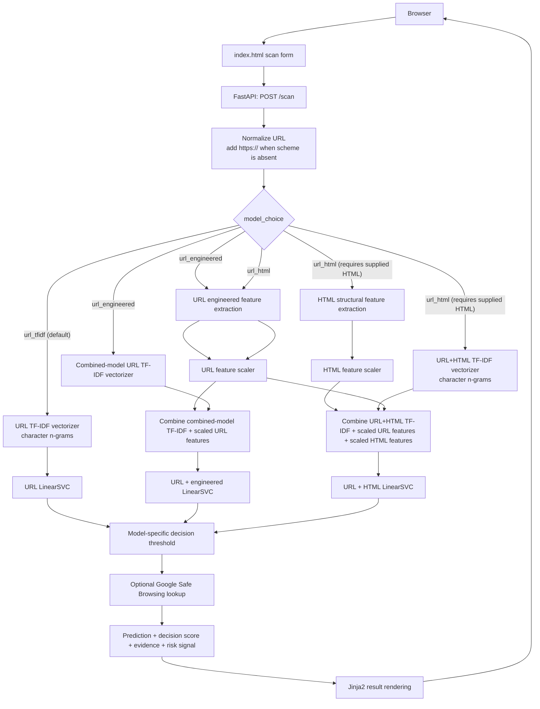

# PHISH//X — Project Structure and Architecture

PHISH//X is a machine-learning phishing website detector. The web application analyzes a submitted URL and can also analyze pasted HTML when the URL+HTML backend mode is selected. Depending on the model score and optional threat-intelligence result, it returns a phishing, likely-benign, or review verdict alongside observable URL/HTML evidence and a qualitative risk signal.

## Project structure

```text
phishing-website-detector/
├── .env                     # Local Google API key; ignored by Git
├── .gitignore
├── data/
│   ├── raw/                 # Source datasets (availability varies by environment)
│   ├── processed/           # Derived datasets and extracted features
│   ├── splits/              # Dataset split files, when present
│   └── benchmarks/          # Benchmark data/cache
├── handoff/
│   └── handoff.md           # Project status, decisions, validation, and rollback notes
├── logs/                    # Run/training logs
├── models/                  # Trained model and preprocessing artifacts
├── patch/
│   ├── backups/             # Pre-threshold-change webapp backups
│   ├── tests/               # Model and threat-intelligence regression tests
│   ├── ROOT_CAUSE.md        # False-positive investigation
│   ├── TEST_REPORT.md       # Commands run and test/evaluation limits
│   └── ROLLBACK.md          # Restore instructions for the saved webapp originals
├── results/                 # Evaluation outputs, comparisons, and predictions
├── src/
│   ├── data/                # Dataset inspection and validation utilities
│   ├── evaluation/          # Model evaluation, threshold, and benchmark scripts
│   ├── features/            # URL and HTML feature extraction
│   ├── models/              # Training, comparison, and research scripts
│   └── reputation/          # Optional Google Safe Browsing lookup
├── webapp/
│   ├── static/
│   │   ├── app.js           # Browser-side interactions
│   │   └── style.css        # Layout and responsive styling
│   ├── templates/
│   │   └── index.html       # Scan form and rendered result
│   └── app.py               # FastAPI entry point and inference orchestration
├── README.md
├── requirements.txt
└── project_structure.txt    # Generated/recorded project tree
```

### Important components

| Component | Responsibility |
|---|---|
| `webapp/app.py` | Loads model artifacts, handles `/` and `/scan`, prepares model inputs, selects a model path, classifies the decision score, and assembles the result context. |
| `src/features/url_features.py` | Extracts URL length, hostname/path properties, character counts, subdomains, query parameters, IP/`@` indicators, HTTPS, and suspicious-word counts. |
| `src/features/html_features.py` | Extracts page structure such as forms, inputs, password fields, links, scripts, iframes, and external form destinations from supplied HTML. |
| `webapp/templates/index.html` | Renders the form, scan result, feature summaries, evidence, and uncertainty messaging. |
| `webapp/static/app.js` | Handles client-side form feedback and small UI interactions. |
| `webapp/static/style.css` | Provides visual styling and responsive result alignment. |
| `models/` | Holds the fitted vectorizers, SVM classifiers, scalers, saved feature-column lists, and historical threshold/error reports. |
| `src/reputation/google_safe_browsing.py` | Performs an optional Google Safe Browsing URL lookup when an API key is configured. |
| `src/models/` and `src/evaluation/` | Contain offline training and analysis code; they are separate from normal web inference. |

## Architecture



### Inference flow

1. The browser submits a URL and optional pasted HTML to `POST /scan`.
2. `webapp/app.py` normalizes a scheme-less URL by prefixing `https://`.
3. The backend selects a model from the `model_choice` request field. If omitted, it uses URL-only analysis when no HTML is supplied and URL+HTML analysis when HTML is supplied.
4. The selected vectorizer and any required feature extractor/scaler transform the input into the feature representation expected by that trained model.
5. The selected LinearSVC produces a decision score. A model-specific threshold determines the binary prediction; score thresholds are not interchangeable between models.
6. When configured, the app sends the submitted URL to Google Safe Browsing. A reported threat match overrides the model verdict to phishing; no match is not treated as proof of safety. If the lookup is unavailable or not configured, its status is displayed and local model behavior remains in effect.
7. The app builds an evidence list from observable extracted features and a risk-level signal, then renders them through `index.html`.

### Available model paths

| Backend choice | Input representation | Model artifacts |
|---|---|---|
| `url_tfidf` (default) | Character-level URL TF-IDF features | `url_tfidf.joblib`, `url_linear_svm.joblib` |
| `url_engineered` | URL TF-IDF plus scaled engineered URL features | `combined_tfidf.joblib`, `url_engineered_scaler.joblib`, `combined_linear_svm.joblib` |
| `url_html` | URL TF-IDF plus scaled URL and HTML structural features | `url_html_tfidf.joblib`, URL scaler, `html_scaler.joblib`, `html_feature_columns.joblib`, `url_html_linear_svm.joblib` |

The current HTML page does not expose a model selector. Normal form submissions automatically use the URL+HTML path when non-empty HTML is pasted; otherwise they use the URL-only default. A client can explicitly submit `model_choice` to select a backend.

### Classification and presentation

`CLASSIFICATION_THRESHOLDS` in `webapp/app.py` currently sets `url_tfidf` to `1.5`, while `url_engineered` and `url_html` remain at `0.0`. Scores below zero are labeled `LIKELY BENIGN`; positive URL-only scores below `1.5` are labeled `REVIEW REQUIRED`; scores at or above the selected model's threshold are labeled `PHISHING`. Risk signals are shown separately from the verdict.

An explicit malware or social-engineering match from configured Google Safe Browsing overrides the model verdict to `PHISHING`. No match, an unavailable service, or a missing key does not count as proof of safety; model uncertainty remains `REVIEW REQUIRED`.

The URL-only threshold is a targeted mitigation for an observed false positive, not a threshold validated against a matching labeled validation set. The available saved threshold report belongs to the URL+engineered model and is not applied to URL-only inference. The LinearSVC decision score is not a calibrated probability. See `patch/ROOT_CAUSE.md`, `patch/TEST_REPORT.md`, and `handoff/handoff.md` for investigation evidence, test results, limitations, and history.

Google Safe Browsing is optional and requires `GOOGLE_SAFE_BROWSING_API_KEY` to be set in the server process before the app starts. When enabled, the full submitted URL is sent to Google for lookup. An explicit threat match overrides the model result to `PHISHING`; a no-match is not proof that a URL is legitimate, and uncertain model results remain `REVIEW REQUIRED`. Missing configuration and service errors are displayed rather than treated as a clean reputation.
