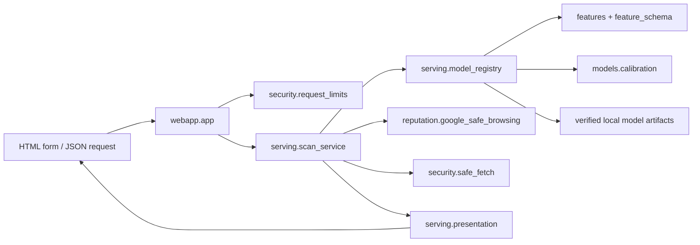

# Repository architecture

PhishReaper separates runtime inference from dataset preparation, training, and evaluation. The supported ASGI entry point remains `webapp.app:app`.

## Runtime request flow

`webapp/app.py` owns HTTP routes, upload decoding, middleware registration, template/static mounting, and translation of service errors into HTTP responses. It constructs a scan service from the current runtime dependencies for each request. This preserves the existing ability to substitute the registry, rate limiter, reputation client, and API key in integrations and tests.

`src/serving/scan_service.py` coordinates URL validation, optional fetching, inference, reputation, shared-hosting policy, evidence, response assembly, and URL-free scan logging. `presentation.py` owns the existing verdict labels and evidence text. `settings.py` reads YAML, environment files, and domain context lists. The web adapter loads model and threshold settings once and passes them to the registry; standalone registry callers can still supply paths.

`src/serving/model_registry.py` verifies artifact paths and SHA-256 hashes, selects the URL-only or URL+HTML model, prepares the exact feature columns, applies calibration, and uses the verified SVM for a failed primary request. Runtime modules do not import training or evaluation modules. Model artifacts and their manifest remain under `models/`.

`src/security/` contains request body/rate limits and bounded safe fetching. Google Safe Browsing remains in `src/reputation/`. Fetching remains disabled by the existing configuration, and reputation calls retain their existing opt-in API-key behavior.

## Source ownership

| Location | Responsibility |
|---|---|
| `webapp/` | HTTP adapter, request schemas, templates, browser assets |
| `src/features/` | Model-compatible URL/HTML extraction and ordered shared schemas |
| `src/models/calibration.py` | Application of fitted calibration artifacts |
| `src/serving/` | Artifact registry, scan orchestration, settings, response presentation |
| `src/security/` | Request limits and guarded network fetching |
| `src/reputation/` | Google Safe Browsing transport/result model |
| `src/data/` | Dataset acquisition, frozen split/data assembly, feature-cache jobs, maintenance |
| `src/training/` | Model fitting, tuning, stacking, categorical ablation, serving-model training |
| `src/evaluation/` | Validation commands, shared metrics, calibration assessment, historical evaluation tools |
| `src/evaluation/locked_test/` | Explicit official-test evaluator implementations |
| `scripts/serving/` | Offline serving smoke command and fixed sanity gate |
| `tests/` | Existing regression suite; pytest is the local and CI runner |

## Stable feature and probability contracts

`src/features/feature_schema.py` owns the categorical column names and the URL-then-numeric-HTML feature ordering. The original extractor functions remain unchanged. Training/data and runtime code consume the same ordered lists.

`src/models/calibration.py` applies the existing Platt and isotonic artifacts. Evaluation and registry compatibility functions delegate to this implementation. Fitting, grouped-OOF selection, thresholds, feature definitions, and artifact contents are not part of a structural migration.

## Data, configuration, and research evidence

`configs/` retains its existing file paths and values. Runtime model selection is in `serving.yaml`; validation-selected cutoffs are in `thresholds.yaml`. Experiment configs retain phase names to match the reports.

Only frozen split manifests/assignments are tracked under `data/splits/`. Raw data, processed caches, and local outputs are outside the runtime image. `experiments/`, `reports/`, and `reports/test_set_access_log.md` retain the existing research and access records.

Official-test evaluation requires separate authorization and a pre-access log entry. Importing the locked-test modules does not invoke their evaluator commands. Routine app and refactor checks must not access official test shards.

## Dependencies and commands

| File | Installation scope |
|---|---|
| `requirements.txt` | App runtime and model inference |
| `requirements-app.txt` | Compatibility alias for `requirements.txt` |
| `requirements-research.txt` | Runtime plus Parquet, fitting, tuning, and evaluation libraries |
| `requirements-dev.txt` | pytest and Ruff tools |
| `requirements-test.txt` | Runtime/research dependencies plus development tools for the complete synthetic/regression suite |
| `requirements-data.txt` | Optional Hugging Face download client |

Run the app with `python -m uvicorn webapp.app:app --host 127.0.0.1 --port 8000`. Run pytest with `python -m pytest -q`. The PowerShell `tasks.ps1 test` command and CI use the same pytest suite.

Canonical research commands include `src.data.splits`, `src.data.html_feature_cache`, `src.training.phase4_boosting`, `src.training.phase6_stacking`, and the validation commands under `src.evaluation`. The serving smoke command is `python -m scripts.serving.serving_smoke`.

## Compatibility during migration

Old `src.evaluation`, `src.features`, `src.models`, and `src.serving` command paths remain import/CLI compatibility modules where implementations moved. Imported compatibility paths resolve to the canonical module object, including private helper names and monkeypatch targets. This also retains lookup of the historical `src.evaluation.phase5_text.NBSVMClassifier` serialization path.

Keep these adapters until external command use and model-serialization references have been reviewed. Historical phase reports continue to describe the commands and code revision used for their experiments. A later package-namespace migration can be made separately once these boundaries are established.
